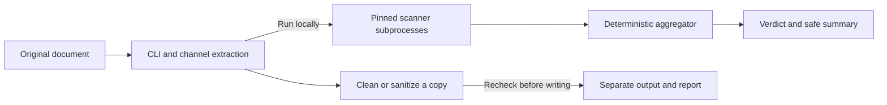

<!-- markdownlint-disable-next-line MD041 -->
<div align="center">

<h1>doc-sentinel</h1>

<p><strong>A local document scanner for people who share files with AI assistants.</strong></p>

<p>
<a href="https://github.com/diegnghtmr/doc-sentinel/actions/workflows/ci.yml"></a>


<a href="LICENSE"></a>
</p>

<p>
<a href="https://diegnghtmr.me/en/work/doc-sentinel/"><strong>Case study</strong></a> &bull;
<a href="#quick-start"><strong>Quick start</strong></a> &bull;
<a href="#architecture"><strong>Architecture</strong></a>
</p>

</div>

A PDF or DOCX can expose text to a model that the person sharing it cannot see. doc-sentinel scans the original with pinned tools and returns a deterministic verdict, with an agent summary that does not quote the document. A separate cleaning command removes known tool traces from a copy without rewriting the author's prose or changing the original.

## Features

- **Local screening.** Check for hidden text, Unicode smuggling, and differences between rendered and extracted text; inspect channels such as filenames, metadata, comments, alt text, and links.
- **Deterministic verdicts.** Merge findings with fixed rules and severity thresholds; failed mandatory checks produce an error, not a clean verdict.
- **Excerpt-free agent output.** Return allow-listed JSON with verdict, grouped counts and locations, fixed explanations, and suggested next steps without including document text.
- **Separate cleaned output.** Remove deterministic Unicode, metadata, and supported embedded-media traces, then re-inspect the result before writing a sibling file or explicit output.
- **Optional checked sanitization.** Remove supported, precisely located findings from a separate copy; refuse ambiguous edits instead of guessing.
- **Pinned tools.** Lock upstream submodules by commit, test updates before accepting them, and roll back a failed pin independently.

## Quick start

The supported full scanner runs on Linux or in a Linux Docker container. Clone with submodules. With Docker running, start with the launcher; it builds `doc-sentinel:local` on first use and passes arguments through to the CLI. Replace `inbox/file.pdf` with a local file and create the report and output directories before using them.

```sh
git clone --recurse-submodules https://github.com/diegnghtmr/doc-sentinel.git
cd doc-sentinel
scripts/doc-sentinel-docker.sh detect inbox/file.pdf --agent-summary
scripts/doc-sentinel-docker.sh clean inbox/file.docx -o reports/file.cleaned.docx
```

On Windows 11, use Docker Desktop in **Linux containers** mode and run the Windows launcher from the repository:

```powershell
.\scripts\doc-sentinel.cmd detect "C:\Users\you\Documents\exam.docx" --agent-summary
```

The launchers check which revision built the image and refresh it if needed. Use `--rebuild` (`-Rebuild` on Windows) to force a rebuild. Windows launcher branches are covered by simulated Docker tests, not a real Windows smoke test. The container runs as UID 10001 without network access or capabilities; the root and input mount are read-only, `/tmp` is tmpfs, and writable outputs, reports, and review directories are separate mounts. `update` and `--allow-network` are unavailable in the container. See [containers/compose.yaml](containers/compose.yaml) for the manual equivalent.

### Native development setup

Install Python **3.12** for the full setup used by CI (the package requires **3.10+**), uv, Node.js **22.13+**, and Rust **1.88+**. On Linux, offline child-process isolation needs unprivileged network namespaces. Use the container for full detection if host isolation is unavailable. Tesseract with English and Spanish data, qpdf, Poppler tools, and LibreOffice with fonts support the full checks; `exiftool` and inspection-only `c2patool` improve verification of metadata and C2PA.

```sh
uv venv -p 3.12 .venv
uv pip install -p .venv -e '.[dev,clean,detect]' -e 'third_party/perlecta-mcp[rendu]' \
  -e third_party/unicode-smuggling-guard
(cd third_party/subtext-scan && npm ci --ignore-scripts)
CARGO_TARGET_DIR=.cache/cargo cargo build --release --manifest-path third_party/chk_defaced-rs/Cargo.toml
mkdir -p bin && cp .cache/cargo/release/chk_defaced bin/
.venv/bin/doc-sentinel version
```

| Variable | Purpose | Default |
| --- | --- | --- |
| `DOC_SENTINEL_HOME` | Override the repository/harness root used to locate local tools. | Detected repository root |
| `DOC_SENTINEL_NO_NETNS` | Declare external network isolation; honored only when no non-loopback interfaces are visible. | Unset |
| `HF_HUB_OFFLINE` | Kept enabled for offline subprocesses; detection never downloads the optional model. | `1` in offline subprocesses |

### Scan, clean, and sanitize

`detect FILE` scans the original; use `--fail-on high` or `--fail-on medium` to gate a workflow and `--json` or `--agent-summary` for machine output. `--report PATH` writes a separate report that may include document text. `clean FILE` writes `<stem>.cleaned<suffix>` by default. Set `-o PATH` or `--output-dir DIR` (not both); neither can overwrite the input, and existing outputs are refused unless `--force-output` is set.

`detect FILE --sanitize` requests a checked sanitized copy. If semantic review is part of the workflow, write batches with `--review-dir DIR`, validate answers with `review-merge`, and use `sanitize FILE --review-dir DIR` against the original with a matching SHA-256. The host-only `review-run` can submit batches to `opencode`, `claude`, or `gemini` with tools disabled; it needs network access and writes replies for merge validation. See the [reviewer prompt](docs/reviewer-prompt.md) and [agent procedures](AGENTS.md). `version` reports pins, `intent` maps a request to a mode, and `update --dry-run` reports candidates without moving pins (`--only ID` selects a tool).

| Exit | `clean` | `detect` | `update` |
| --- | --- | --- | --- |
| `0` | Cleaned or already clean | Clean, or findings below the requested threshold | Pins unchanged or updated |
| `1` | Residual C2PA or AI metadata | Findings at or above the requested threshold | A pin was rolled back |
| `2` | Tool error, unsupported format, or unsafe path | A mandatory layer failed | Fetch or operational error |

Sanitizing preserves the original detection verdict. A refusal exits `2`, and `nothing_to_do` creates no copy. Follow the safe summary's output path: unsafe input names are not reused, and a sanitized PDF becomes a `.docx`, not an edited PDF. Reconstruction preserves detected visible content where possible; layout can differ and scanned pages remain images without an added OCR layer. Reports may include removed text; agent summaries do not.

## Architecture

The Python CLI extracts separate channels and runs file-type adapters from pinned Git submodules. Detection defaults to a scrubbed environment with offline child processes; if isolation or mandatory extraction fails, the verdict is an error. Cleaning and sanitizing are separate from verdict aggregation and only publish copies after checks pass. See the [design plan](PLAN.md) for the pinning and verification rationale.



Cleaning does not remove statistical text or pixel watermarks. XLSX, PPTX, EPUB, and ODT checks inspect extracted text but not hidden structure. English and Spanish rules can miss paraphrases or other languages; visible discussion can produce a finding, and OCR failures may be skipped. Optional `detect --prompt-guard` requires the `promptguard` extra and a cached, separately licensed Prompt Guard 2 model; it is never downloaded by detection, and an unavailable optional adapter is reported as skipped. Review verifies supported edits with extraction, re-detection, and applicable rendering checks; it refuses unlocatable glyph divergence and ambiguous native PDF matches.

## Tech stack

| Layer | Technology |
| --- | --- |
| CLI and aggregation | Python, PyYAML |
| Document parsing and render checks | PyMuPDF, pikepdf, python-docx, LibreOffice, Tesseract |
| Pinned adapters | watermarks-remover, Perlecta, hidden-text-detector, subtext-scan, chk_defaced-rs, unicode-smuggling-guard |
| Runtime isolation and validation | Linux namespaces, Docker, pytest, Ruff |

Built-in channel extraction and instruction rules run without a model. chk_defaced-rs runs as a separate executable. Sub-harnesses retain their own licenses; see the pinned checkout and [design plan](PLAN.md).

## Testing

```sh
.venv/bin/pytest -q -m "not integration"
.venv/bin/pytest -q
```

[CI](.github/workflows/ci.yml) runs Ruff, unit tests across Python 3.10–3.13, pin validation, the full corpus with sub-harnesses installed, and an offline container round trip that checks the original remains unchanged. The [scheduled dry run](.github/workflows/update-dry-run.yml) checks upstream revisions without moving pins. Corpus fixtures are generated by [tests/corpus/generate.py](tests/corpus/generate.py); local user samples are not part of the committed corpus.

## Documentation

Read the [scanner and copy-safety reference](docs/scanner-reference.md) for the command options, adapter roles, and known limits of detection and sanitization.

## License

[MIT](LICENSE) for doc-sentinel. Pinned tools and the optional model retain their respective licenses.
